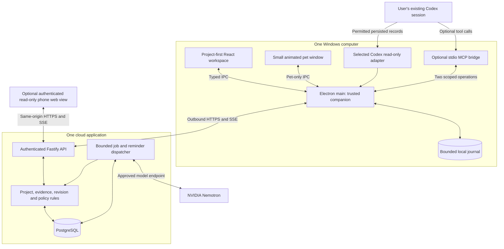
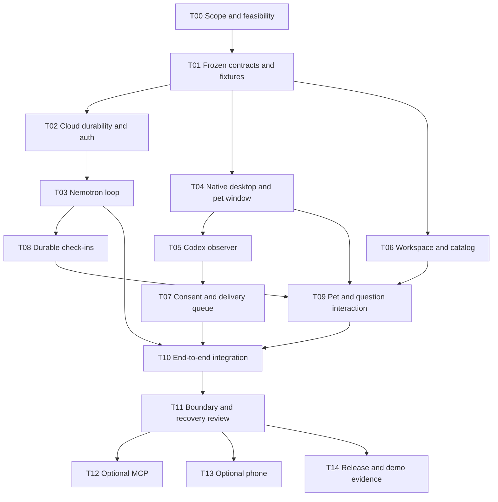

# Living Playbooks: Base Architecture and Parallel Build Master Plan

> **For implementation agents:** Use `superpowers:subagent-driven-development` or `superpowers:executing-plans` when available, with test-driven development and verification before completion. The coordinator assigns the parallel lanes below. Do not independently spawn extra workers, change shared contracts, or expand the product scope. Checkboxes describe future implementation, not completed work.

**Goal:** Build a standalone, project-first desktop application in which Nemotron understands a project, interprets permitted activity from one Codex conversation, updates an interactive workspace, and checks in through an animated desktop pet.

**Architecture:** One Windows Electron application, one cloud Node/Fastify application, and one persistent PostgreSQL database. The cloud application contains the API, bounded Nemotron runner, and durable reminder dispatcher as modules in one deployment. The desktop owns its windows, consented local observation, and a small durable upload queue.

**Tech stack:** TypeScript, React, Vite, Electron, Fastify, PostgreSQL, Zod, Vitest, Playwright, and an explicitly configured NVIDIA Nemotron endpoint. An MCP SDK is an optional late dependency. No mandatory Redis, NATS, Temporal, vector database, agent framework, or separate server per project.

**Spec:** The simplified architecture accepted in the conversation, made self-contained in Sections 1-15 of this document. The earlier `living-playbooks-project-companion-architecture.md` is long-term background; the simplifications and deferrals in this master plan take precedence for the hackathon.

**Prepared:** November 7, 2026.  
**Status:** Planning artifact only. No product code, cloud deployment, model call, local-history access, or phone connection was performed in preparing this file.  
**Time constraint:** A 24-hour competition. The allocations below are planning checkpoints, not delivery guarantees or an assumption that all 24 hours remain.  
**Execution model:** One coordinator and three implementation lanes in parallel, followed by integrated review. These are development agents helping build the app, not agents or employee computers inside the finished product.

## Global constraints

- Build a new application with a separate name, profile, and data directory. This is not a Maritime project, a company simulator, or a Gen V1 plug-in.
- Keep projects and manager icons on the left, a useful project workspace in the center, and project chat on the right.
- Preserve the core loop: **observe -> understand -> validate -> update -> check in -> remember the answer**.
- One visible animated pet represents the selected or pinned project. Animation is local, not model-driven frame generation.
- Use real Nemotron calls for project planning, tool selection, evidence interpretation, and structured workspace proposals. Never relabel another model as Nemotron.
- Start with one owner, one Windows installation, one explicitly linked Codex thread per demonstrated project, and one verified source-reading strategy.
- Reading a coding thread must not start/resume a turn, inject messages, approve tools, interrupt work, modify configuration, or alter history.
- Monitoring and source-text export are off until explicit consent. Raw archives, credentials, hidden reasoning, and unrelated threads are excluded.
- MCP is a tool connection, not a transcript-reading permission. Its two proposed tools are an optional extension to the observer, not a replacement.
- No unrestricted generated JavaScript, remote shell, autonomous code edits, purchases, social publication, or production deployment from the project manager.
- SMS, advanced presence routing, full second-PC observation, other harness adapters, arbitrary PDF extraction, and voice/3D pets are not on the critical path.
- Preserve authentication, source scope, idempotency, stale-result rejection, evidence labels, and user drafts even in the hackathon version.
- A mock, imported recording, or fixture must remain labeled as such. Do not present fallback manual import as automatic observation.
- The plan does not authorize provision of paid infrastructure, access to private histories, or modification of existing repositories. Implementation uses a deliberately selected workspace and authorized accounts.

## Review focus

1. A Codex source changes or stops persisting records: observation becomes stale or blocked, not a fabricated successful update. Tests: T05, T11.
2. The user edits a task or revokes sharing while Nemotron is responding: the late proposal cannot overwrite the new decision or use revoked source content. Tests: T03, T07, T11.
3. An upload or check-in acknowledgment is lost: retries do not create duplicate evidence, progress changes, or routine pet interruptions. Tests: T02, T07, T08, T11.
4. Generated content or an MCP caller tries to read another project or execute a command: server/main-process scope checks reject it. Tests: T04, T06, T12.
5. A polished UI hides a missing integration: connection, inference, observation, and synchronization states expose the real mode and last successful observation. Tests: T09, T10, T14.

---

## Contents

1. Product boundary and definition of done
2. Decisions that reduce the build
3. System architecture and ownership
4. Golden workflow and challenge fit
5. Shared contract to freeze before parallel work
6. Persistence and concurrency
7. Cloud API and client contract
8. Nemotron execution loop
9. Codex observation and privacy
10. Desktop companion, local queue, and pet
11. Project-first UI and generative catalog
12. Check-ins and notification behavior
13. Optional MCP and phone extensions
14. Security, deployment, and resource limits
15. Repository layout and Gen reuse
16. Parallel-agent operating plan
17. Task dependency map
18. Implementation tasks T00-T14
19. Verification and acceptance matrix
20. Competition checkpoints and cut rules
21. Demonstration and evidence package
22. Expansion path, open gates, sources, and review record

## 1. Product boundary and definition of done

### 1.1 One sentence

**A project companion that understands what you are building, follows selected work in your coding tool, builds a useful interface around the project, and asks the next useful question without becoming another noisy chatbot.**

Each project has its own name, manager identity, pet icon, conversation, requirements, and evidence. They are database records served by a shared cloud application, not separate continuously running AI processes.

### 1.2 Base architecture versus the complete product

| Must work in the base | Useful after the core passes | Explicitly deferred |
|---|---|---|
| Standalone Windows desktop shell and one pet | Two project-scoped MCP tools | Universal harness support |
| Three-pane project workspace and saved chat | Read-only phone browser view | A second PC collecting local evidence |
| Prompt or bounded UTF-8 `.txt`/`.md` brief | One read-only GitHub PR lookup | Generic PDFs, scans, OCR, video understanding |
| Real Nemotron tool/structured-result loop | Small UI polish and additional original pet frames | Arbitrary generated applications |
| One consented, automatic Codex observer | SMS only after actual access is proven | Advanced cross-device attention routing |
| Evidence-labeled task updates | Another project demonstrated with the same adapter | Voice, 3D, marketplaces, multi-user billing |
| Persisted reminders, pet question, answer, snooze | Portable unsigned Windows build if already reliable | Full installer/updater/signing project |
| Cloud persistence, authentication, reconnect | Basic operational metrics | Distributed services or automatic agent spawning |

A prompt-only project is legitimate. A new project must not require existing chat history or pretend to have past progress. Document requirements and model-suggested milestones must be distinguished.

### 1.3 A base release passes only when

- [ ] A real Nemotron response creates a validated, editable project plan and working interface.
- [ ] The owner can correct a task or draft, refresh, and retain the correction.
- [ ] A real new record from the selected running Codex workflow is read without sending an instruction to Codex.
- [ ] Its permitted representation reaches the cloud once and affects only the linked project.
- [ ] Nemotron interprets it using project/evidence tools and produces a traceable update, not a hard-coded progress increment.
- [ ] A real desktop pet displays one relevant due question; answer and snooze work and persist.
- [ ] Restarting the cloud application does not lose accepted work or make old proposals valid again.
- [ ] Closing the main window leaves the explicitly running companion/pet alive; Quit stops local observation and makes source freshness honest.
- [ ] Source export and updates remain subject to current consent; authentication is not disabled for the demonstration.
- [ ] The demo distinguishes live, replayed, reported, observed, and unavailable results.

SMS and MCP do not block this base release. Automatic observation and real Nemotron use do. If either fails its live gate, return a useful partial prototype but label the missing core capability.

## 2. Decisions that reduce the build

These are implementation recommendations made for this master plan, not claims about features already present.

| Decision | Chosen base | Reason and upgrade path |
|---|---|---|
| Deployments | One cloud application process plus PostgreSQL | API and bounded dispatcher share code and deployment. Split processes only when measured requirements justify it. |
| Background work | Small PostgreSQL `jobs` and `checkins` tables | Timers survive restarts without adding a queue service. Do not build a general workflow engine. |
| Live UI updates | HTTPS commands plus SSE invalidations and snapshot refetch | One-way updates are enough. This deliberately simplifies the earlier WSS proposal; WebSocket is not a prerequisite. |
| Local persistence | Bounded, single-writer atomic journal behind `LocalStore` | Avoid native SQLite packaging work for a small spool. A previously proven SQLite implementation can substitute only at T00 before contract freeze. |
| Authentication | One operator-provisioned owner; short-lived one-use pairing grants | No public signup or identity-provider integration on the critical path. Production authentication is later work. |
| Generative UI | Six trusted components with stable IDs and data references | Dynamic composition without executing generated application code. |
| Model loop | One cloud Nemotron runner, bounded calls and tools | No imported Hermes/Codex agent engine is needed to manage the playbook. Codex is observed, not used as the manager. |
| Source support | One installed-version-specific Codex adapter | Prove one real integration instead of building an incomplete abstraction for every harness. |
| Data ingestion | Prompt, plain text, or Markdown; final user-visible source messages only initially | No new OCR/document pipeline. A file-selection control must state the supported types. |
| Reminder routing | One desktop recipient, account-wide caps, no presence inference required | The pet and in-app question share one ID. Multi-device routing remains an extension. |
| Distribution | Local/source launch or an already-working portable build | An installer is not the project. Avoid breaking the source demo to add release automation. |

### 2.1 Alternatives not selected

A local-only build is simpler but does not prove cloud continuity. A cloud-only build cannot provide a genuine desktop overlay or local-thread observer. A distributed service-per-manager design adds operational overhead without improving the first demonstration. The hybrid layout is retained, with only one cloud deployment.

Do not add iii, NATS, Temporal, Supabase-specific coupling, a vector database, or another agent runtime merely because they appeared in earlier research. None is required by this architecture.

## 3. System architecture and ownership



| Component | Owns | Does not own |
|---|---|---|
| Electron main | Native windows, local source consent, source reader, journal, device token, cloud connection | Model credentials, arbitrary cloud-command execution |
| Workspace renderer | Layout, visible drafts, explicit user actions | Node, filesystem access, model/provider tokens, arbitrary IPC |
| Pet renderer | Asset animation and question presentation | Separate memory, model loop, scheduling, source access |
| Cloud domain | Canonical project state, evidence references, permissions, revisions | Trust in source prose as an instruction |
| Nemotron runner | Interpretation, bounded tool selection, state/layout/check-in proposals | Direct SQL, source-grant mutation, SMS sending, local commands |
| Dispatcher | Claiming due jobs, applying verified results, making questions eligible | Inventing completion or independently replanning projects |
| Codex observer | Parsing/fetching records inside the selected grant | Controlling the observed harness |
| Optional MCP bridge | Reading a scoped brief and submitting an agent progress report | Reading the host's entire chat, approving work, unrestricted API proxying |

The cloud database is the sole authority for synchronized project state. The desktop journal is a delivery/cache mechanism, not a second project scheduler. Closing a window does not cancel cloud jobs. Sleeping a laptop does stop new local observations.

## 4. Golden workflow and challenge fit

### 4.1 One complete scenario

1. The user creates **Hackathon Demo** from a short text brief with application, tests, and demo-recording requirements.
2. Nemotron reads the stored brief through an actual tool call, proposes milestones and an interface, and the application validates them.
3. The user accepts or edits the proposed requirements. The workspace shows source-derived requirements separately from optional suggestions.
4. The user links one selected Codex conversation and explicitly authorizes the displayed excerpt-sharing policy.
5. The user performs ordinary work in Codex. The observer notices a newly persisted final message or permitted tool-result metadata without changing the session.
6. The cloud stores the observation, Nemotron retrieves it, and a relevant task changes to a labeled state such as **implementation reported complete**.
7. The recording task remains unresolved. With reminders enabled and a due follow-up, a targeted question appears in the pet.
8. The user answers **Not yet** or **Recorded**, or chooses **Snooze**. The same question changes in chat and the workspace; the response survives reload.
9. An optional authenticated phone page shows that saved state. This is cross-client viewing, not proof of second-PC source observation.

### 4.2 Challenge mapping

The uploaded slide requires Nemotron, more than chat, multi-step work, tool integration, and a real use case. It does not define acceptance of pre-existing code, local integrations, or specific endpoints.

| Slide requirement | Demonstrable implementation |
|---|---|
| Use Nemotron | Recorded model ID/request metadata and genuine tool-selection/result interpretation |
| Beyond a chatbot | Project workspace, real source observations, persisted questions, desktop interaction |
| Multi-step workflows | Brief -> plan -> observed work -> evidence update -> check-in -> answer |
| Tool integration | Read the actual Codex source and retrieve project/evidence through tools; optional GitHub API read makes the external-service part especially visible |
| Real-world applicability | Reduce repeated project explanations and missed deliverables while the person continues using their preferred coding tool |

Ask organizers about reuse and whether their tool-integration criterion requires a remote service beyond the model endpoint. Do not silently build a larger integration platform. If needed, add exactly one read-only GitHub PR lookup after the core passes and access is confirmed.

## 5. Shared contract to freeze before parallel work

The coordinator owns `packages/contracts/`. All lanes use its exported schemas and fixtures. TypeScript interfaces are derived from Zod schemas, not independently retyped in each app. The following names and semantics are binding design decisions; implementation details can be smaller than these descriptions.

### 5.1 Core records

| Type | Required fields and meaning |
|---|---|
| `Project` | `id`, `ownerId`, `title`, `goal`, `revision`, `epoch`, `planState`, `phase`, `status`, `manager`, `tasks`, `decisions`, `workspace`, `updatedAt` |
| `ManagerIdentity` | `id`, `projectId`, `displayName`, `petPackId`, `promptVersion`; no separate cloud VM |
| `Task` | `id`, `title`, `status`, `revision`, `requirementOrigin`, `evidenceLevel`, `evidenceIds`, optional `dueAt`, `ownerOverride` |
| `SourceBinding` | `id`, `projectId`, `deviceId`, opaque `sourceKey`, `adapterId`, `adapterVersion`, `capability`, `grantRevision`, `exportPolicy`, `state`, `lastObservedAt` |
| `Observation` | `id`, `bindingId`, `grantRevision`, `sourceItemId`, `sourceRevision`, `kind`, `occurredAt`, `observedAt`, permitted `excerpt`, permitted `metadata`, `provenance` |
| `ManagerProposal` | `schemaVersion`, `jobId`, `baseProjectRevision`, `projectEpoch`, `grantVersions`, `taskChanges`, `decisionSuggestions`, `workspace`, optional `questionSuggestion`, `reply` |
| `WorkspaceSpec` | `schemaVersion`, stable `id`, `revision`, ordered `panels`; panel values reference project entities rather than duplicate task state |
| `DocumentDraft` | `projectId`, `id`, `revision`, `text`, `updatedBy`; owner-authored text is not replaced by a model layout |
| `CheckIn` | `id`, `projectId`, `taskId`, `subjectRevision`, `question`, `dueAt`, `expiresAt`, `state`, `presentationId`, optional `snoozedUntil`, `answer` |
| `CommandEnvelope<T>` | `operationId`, `expectedRevision` where relevant, `input`; actor identity comes from authentication |
| `CommandReceipt<T>` | `operationId`, `requestHash`, `status`, `result`, `projectRevision`, `eventSequence`; accepted is not completed |
| `ProjectSnapshot` | Current project, bounded evidence/messages/documents/check-ins, source states, `eventSequence`, capability availability |
| `SourceCursor` | Adapter/version, selected-source identity, last complete item/version; file mode additionally tracks identity and last complete byte boundary. Cloud never accepts a local path as this cursor. |
| `ObservationBatch` | Validated records, next cursor, coverage/mode, last-observed time, and explicit truncation or compatibility error |
| `ObserverCapabilityReport` | Installed version, tested read strategy/methods, capability mode, limitations, and safe error; capability discovery alone does not mean live-tested |
| `AcceptedJob` | Original command receipt, job ID, and actual queued/running state |
| `CheckInAnswer` | `recorded` or `not_yet`, optional bounded owner note, and expected check-in revision; snooze uses a separate command |
| `SnoozeInput` | Exact `until` timestamp and confirmed IANA timezone; no ambiguous natural-language time silently accepted |
| `ApiError` | `code`, safe `message`, `retryable`, optional `currentRevision` and `capability`; no stack/secrets in client responses |

### 5.2 Exact enums

```ts
type PlanState = 'proposed' | 'accepted';
type ProjectStatus = 'active' | 'paused' | 'archived';
type ProjectPhase = 'planning' | 'building' | 'demo' | 'review';
type TaskStatus = 'todo' | 'in_progress' | 'blocked' | 'done' | 'skipped';
type EvidenceLevel = 'none' | 'agent_reported' | 'user_reported' | 'source_tool_observed';
type RequirementOrigin = 'brief' | 'owner' | 'model_suggestion';
type ExportPolicy = 'off' | 'metadata_only' | 'approved_excerpts';
type SourceCapability = 'unavailable' | 'history_only' | 'incremental_history';
type SourceState = 'unlinked' | 'awaiting_consent' | 'following' | 'paused' | 'stale' | 'blocked' | 'revoked';
type ObservationKind = 'user_visible_message' | 'assistant_report' | 'tool_result_metadata' | 'activity';
type CheckInState = 'scheduled' | 'available' | 'presented' | 'snoozed' | 'answered' | 'cancelled' | 'expired';
type PetState = 'idle' | 'reviewing' | 'waiting_for_you' | 'milestone' | 'snoozed' | 'offline';
type PanelType = 'checklist' | 'milestone_timeline' | 'evidence_card' | 'question_card' | 'document_editor' | 'next_action';
```

Do not add an `independently_verified` state just because a transcript contains a passing test. `source_tool_observed` means a result was observed in that source, not that this application independently reran it. A screenshot of a file or an agent saying “done” is not execution proof.

### 5.3 Identifiers, scope, and revisions

- Use UUIDs for app objects and operation IDs. Keep vendor thread/item IDs as opaque strings behind `SourceBinding`.
- Scope every read/write to the authenticated owner, project, and, for ingestion, device and source binding.
- The cloud does not receive a caller-supplied owner ID as authority.
- Every canonical project change increments `Project.revision`; pause/revocation/cancellation also invalidates applicable work through epoch/grant checks.
- Evidence ingestion counts as a context change. Check-in display acknowledgments and model-token streaming do not trigger a new reflection loop.
- Document edits use their own revisions and are never replaced as a side effect of a new workspace layout.
- A reused operation ID with identical canonical arguments returns its original receipt. Different arguments produce `IDEMPOTENCY_CONFLICT`.
- Deduplicate source items by `(bindingId, sourceItemId, sourceRevision)`, even if the device generates a new upload operation ID.
- The UI must not infer capabilities from missing fields. Return explicit `{ available: false, reason }`.

### 5.4 Limits, all configurable and recorded

| Limit | Initial implementation default |
|---|---:|
| Brief input | 64 KiB UTF-8, `.txt` / `.md` / prompt only |
| Tasks per project | 40 |
| Workspace panels | 12, depth at most 2, six component types |
| Observation excerpt | 4 KiB, completed user-visible text only |
| Ingestion batch | 20 observations and 128 KiB total |
| Local spool | 1,000 pending observations or 10 MiB, whichever comes first |
| Manager context | 48 KiB assembled text plus schema/tool metadata within a separately measured cap |
| Model calls per job | 4 maximum, including any repair call |
| Tool calls per job | 6 maximum, read-only tool surface |
| Manager job deadline | 120 seconds including tool/model calls |
| Active manager jobs | 1 globally for the demo; per-project overlap forbidden |
| Source polling | 30 seconds active; 120 seconds idle; manual refresh permitted |
| Observation coalescing | 10 seconds; no model run on heartbeat/duplicate only |
| Check-in dispatcher | Inspect due rows every 15 seconds while cloud process is running |
| Unsolicited questions | 3/day account-wide, 60-minute spacing, 1 unanswered/project |
| Quiet hours | 21:00-09:00 in a user-confirmed IANA timezone |
| Demo reminder mode | Explicit on-screen badge; 20-second due interval; SMS remains off |

These are bounded design choices, not benchmarks. The implementation must record actual latency and revise limits deliberately if required, never silently reroute to a different model.

## 6. Persistence and concurrency

### 6.1 Cloud schema

Use straightforward SQL migrations and parameterized `pg` queries. Do not introduce an ORM/code-generator migration project solely for the hackathon.

| Table | Minimum purpose and constraints |
|---|---|
| `owners` | Single operator-provisioned owner, confirmed timezone, reminder preferences |
| `credentials` | Hashed one-use pairing grants and scoped access credentials; kind, owner, device, expiry, consumed/revoked times; never store bearer plaintext |
| `projects` | Owner, revision, epoch, canonical JSONB project state and workspace spec, status; row lock for mutation |
| `source_bindings` | Project/device, opaque source identity, consent mode/revision, state and freshness; no local absolute paths |
| `observations` | Immutable permitted observation data, binding/grant/source identity; unique source-item-version key |
| `messages` | Project manager chat only, owner/manager roles, operation/job correlation; coding transcripts remain observations |
| `documents` | User document bodies and independent revision; project plus document unique key |
| `jobs` | Type, project, immutable input references, state, `runAfter`, lease/generation, tries, sanitized result/error |
| `checkins` | Subject/task revision, question, due/expiry, state, answer, presentation identity; one open routine question/project |
| `command_receipts` | Actor/operation unique key, canonical request hash, result, event sequence |
| `events` | Increasing sequence, owner/project, kind, resource reference and revision; minimal payload for SSE/snapshot recovery |

Keep task and decision arrays inside `projects.state` for the small MVP. This avoids unnecessary joins while allowing atomic revision checks. Split them into separate tables later only if measured requirements justify it.

### 6.2 Transaction rules

A domain command authorizes the caller, checks its receipt, locks the project row, verifies the expected revision, mutates state, appends an event, records any needed job/check-in and the receipt, then commits. The same transaction creates the durable work record; do not depend on an in-memory callback to remember it afterward.

External API/model calls never execute inside a database transaction. A worker claims a job, captures its project revision/epoch and grant versions, releases the transaction, performs bounded work, then rechecks those values before commit.

A stale proposal is not partially merged by guesswork. Mark it superseded, retain a safe diagnostic, and schedule at most one replacement against current state. After two stale generations for the same burst, wait for a quiet interval or explicit user input rather than churn indefinitely.

### 6.3 Minimal durable dispatcher

The cloud process runs one dispatcher with a heartbeat and lease generation. Use transactional row claims such as `FOR UPDATE SKIP LOCKED` for due jobs; that mechanism is documented for queue-like access [R6].

Use a 180-second lease renewed every 30 seconds while the 120-second bounded job is active. Capture and recheck lease generation at commit. On startup, reconcile expired jobs before claiming new ones. A lost lease prevents old completion from committing. An unknown interrupted model call may have incurred provider usage even when its output was not saved; do not claim exactly-once inference or zero cost. At most one bounded retry is allowed where policy permits, and it counts toward usage limits.

A provider timeout does not retry indefinitely. Authentication and unsupported-schema errors are blockers. An invalid proposal may get one repair call only inside the same four-call budget; otherwise retain the last valid project view.

No public side effects are part of the base runner. Optional SMS would need a separate durable intent/reconciliation path, not the generic job retry behavior.

### 6.4 Owner and source changes during work

An owner correction sets the affected task's `ownerOverride` and records a decision. Nemotron can suggest revisiting it but cannot silently replace it. Revoking a source increments its grant revision, rejects queued uploads, invalidates dependent in-flight proposals, removes retained excerpts when requested, and withdraws or marks derived claims requiring review. Track observation dependencies on generated replies and summaries so source-derived excerpts can also be removed or made unavailable there. Minimal tombstones retain no transcript body. An old offline queue cannot recreate revoked text.

## 7. Cloud API and client contract

`packages/api-client` is coordinator-owned and generated/implemented against the shared schemas. The React UI consumes this interface, not hard-coded mock-only data paths.

### 7.1 HTTP endpoints

| Method/path | Caller and effect |
|---|---|
| `GET /health/live` | No secrets, no project data; process liveness |
| `GET /health/ready` | Minimal readiness; detailed diagnostics require owner authority |
| `POST /v1/auth/redeem` | Exchange one-use pairing grant for a scoped credential; rate-limited |
| `GET /v1/projects` | Owner lists compact project summaries |
| `POST /v1/projects` | Create project and initial plan job from a bounded brief |
| `GET /v1/projects/:id/snapshot` | Authorized bounded snapshot and event sequence |
| `POST /v1/projects/:id/actions` | Typed owner actions: accept plan, update task, record decision, pause/resume project |
| `DELETE /v1/projects/:id` | Explicit owner deletion; fence jobs/grants, remove content, retain minimal non-content replay tombstones |
| `POST /v1/projects/:id/messages` | Persist owner message and queue response; returns accepted receipt/job ID |
| `PUT /v1/projects/:id/documents/:documentId` | Revision-checked explicit user draft save |
| `POST /v1/projects/:id/sources` | Enroll an opaque device binding with explicit disclosure policy |
| `POST /v1/sources/:id/state` | Owner/device pause or resume within the existing grant; cannot expand disclosure or select a new source |
| `POST /v1/sources/:id/revoke` | Current owner/device authority; fence exports and invalidate dependent work |
| `POST /v1/sources/:id/observations` | Device ingestion, bound to the authenticated source/project |
| `POST /v1/sources/:id/health` | Safe timestamps/mode/error class only; never creates inference by itself |
| `GET /v1/events?after=<seq>` | Authorized SSE invalidations; current permissions are rechecked |
| `POST /v1/checkins/:id/presented` | Desktop acknowledgment of an actual presentation attempt |
| `POST /v1/checkins/:id/answer` | Authenticated owner answer, idempotent, subject revision checked |
| `POST /v1/checkins/:id/snooze` | Explicit due time, user timezone, revision and deduplication checks |
| `POST /v1/checkins/:id/cancel` | Stop that question; does not mark its task done |
| `POST /v1/jobs/:id/cancel` | Owner cancellation fences completion and aborts owned model request if possible |

All mutating domain endpoints use `CommandEnvelope`. Source observation metadata can identify a source item but cannot select another owner. HTTP status conventions: 401 missing/expired auth, 403 denied, 404 unavailable object without cross-project leakage, 409 revision/idempotency conflict, 422 invalid contract, 429 bounded usage/rate limit, 503 unavailable dependency.

### 7.2 Client interface

```ts
interface PlaybooksClient {
  listProjects(signal?: AbortSignal): Promise<ProjectSummary[]>;
  createProject(input: CommandEnvelope<CreateProjectInput>): Promise<AcceptedJob>;
  getSnapshot(projectId: string, signal?: AbortSignal): Promise<ProjectSnapshot>;
  sendMessage(projectId: string, input: CommandEnvelope<MessageInput>): Promise<AcceptedJob>;
  applyAction(projectId: string, input: CommandEnvelope<OwnerAction>): Promise<CommandReceipt<Project>>;
  saveDocument(projectId: string, documentId: string, input: CommandEnvelope<DocumentInput>): Promise<CommandReceipt<DocumentDraft>>;
  answerCheckIn(id: string, input: CommandEnvelope<CheckInAnswer>): Promise<CommandReceipt<CheckIn>>;
  snoozeCheckIn(id: string, input: CommandEnvelope<SnoozeInput>): Promise<CommandReceipt<CheckIn>>;
  subscribe(after: number, onEvent: (event: ProjectEvent) => void, signal: AbortSignal): Promise<void>;
}
```

`ProjectSummary`, input schemas, `AcceptedJob`, and `ProjectEvent` are defined in T01, not invented independently by lane authors. `AcceptedJob` includes the receipt, job ID, and actual state; it is never a fabricated completed result.

### 7.3 SSE rules

SSE carries `{seq, projectId, kind, resourceId, revision}` and no full source transcript. Receiving an event invalidates the relevant bounded snapshot. Reconnect from the last accepted sequence; a missing/expired cursor requires a fresh authorized snapshot. Keep an offline indicator until refreshed.

The desktop main process authenticates the stream and forwards safe events to the renderer. It never exposes the bearer token through preload. The optional phone uses a same-origin authenticated cookie. SSE is a notification path, not the canonical record or an approval channel.

## 8. Nemotron execution loop

### 8.1 Essential integration

Use a small typed adapter, not an entire new agent framework. The configured endpoint/model must pass a real capability probe: authenticated response, one function tool call, a tool-result continuation, and output that passes the shared schema. NVIDIA documents these features on particular endpoints, but availability and settings vary [R1].

Record the exact endpoint/model and actual request settings. No hard-coded assumption about a free tier, unlimited credits, a particular reasoning setting, or an untested model alias. Never silently substitute another provider.

### 8.2 Proposed interfaces

```ts
interface NemotronAdapter {
  probe(signal: AbortSignal): Promise<ModelCapabilityReport>;
  next(input: ModelTurnInput, signal: AbortSignal): Promise<ModelTurnResult>;
}
interface ProjectManagerRunner {
  run(job: ManagerJob, context: AuthorizedProjectContext, signal: AbortSignal): Promise<ManagerProposal>;
}
```

Freeze those DTO schemas in T01. Native provider-specific message formatting stays inside `packages/nemotron`, not in UI or project records.

### 8.3 Allowlisted tools

| Tool | Allowed behavior |
|---|---|
| `read_project_state` | Read the assigned project's current brief, accepted tasks, decisions, and source health |
| `list_recent_evidence` | List bounded metadata for observations still covered by current grants |
| `read_evidence` | Read a bounded permitted excerpt by ID, not an arbitrary URL/path |
| `read_project_document` | Read a project-owned draft explicitly available to this manager |
| Optional `read_github_pr` | Read metadata/check status for one owner-approved repository/PR; no write token or arbitrary URL fetching |

The tools return real stored/source data with provenance. They do not create facts or silently execute mutation requests. The final structured proposal is applied by the domain validator. A live demonstration must show an actual model-selected tool and follow-up interpretation, not only a model call that produces a prefilled page.

### 8.4 Processing algorithm

1. Claim a due job and capture current project/grant revisions.
2. Assemble the bounded brief, unresolved tasks, latest owner input, and evidence IDs. Do not preload unrelated threads or the entire archive.
3. Invoke Nemotron with the allowed tools and structured final-result schema.
4. Validate each tool name/arguments, enforce scope, execute it, and return bounded results. Record tool name, input references, result digest, and timing without secrets or hidden reasoning.
5. Stop within the call/tool/deadline limits. An empty change set is a valid outcome.
6. Validate returned IDs, task statuses, evidence references, component types, question bounds, and semantic restrictions. A model cannot promote itself to owner or create an unsupported verification label.
7. Recheck project revision/epoch and source grants in a new transaction, commit accepted changes once, and append a minimal event.
8. Update UI from the committed state, not streamed partial JSON. A reply may explain uncertainty but cannot override the record.

### 8.5 Avoid loops and cost surprises

Only meaningful new evidence, owner messages, or an explicitly scheduled review can request reflection. Heartbeats, UI redraws, pet animation, SSE reconnection, and the model's own accepted update must not recursively schedule more inference.

Persist call counts and last error. Configure a finite account-wide request/token allowance at setup. Unknown dollar cost is shown as unavailable; it is not zero. Handle provider 429/reset information with queue backoff, not account rotation.

## 9. Codex observation and privacy

### 9.1 Decide the route early

T00 must prove one compatible route on the actual Windows installation using a harmless user-selected thread. The plan does not assume that an App Server process can see another process's live state.

**Preferred candidate:** the official App Server's supported stored-history reads. Current documentation describes thread listing, metadata reads, and paginated history methods; reading history is different from resuming/subscribing [R2]. Pin the installed version and its supported methods. Reject unknown operations.

**Explicit fallback:** a version-specific, read-only parser for one user-selected persisted session file, only when the user permits that mode. Validate its actual record format before use. Do not recursively scan the entire profile or label a user-input history file as a complete conversation.

Enrollment follows new records from a known baseline by default. Any bounded historical import requires a separate explicit choice and remains identified as imported history; no automatic backfill of the archive. Implement the route that passes. Do not build both fully during the event. If neither works, retain a clearly marked manual-import/MCP-report fallback and mark automatic observation blocked. Do not conceal that loss of the core capability.

### 9.2 Observer interface

```ts
interface CodexObserver {
  probe(): Promise<ObserverCapabilityReport>;
  readDelta(binding: LocalBinding, cursor: SourceCursor | null, signal: AbortSignal): Promise<ObservationBatch>;
  stop(bindingId: string): Promise<void>;
}
```

`LocalBinding` contains local resolved identity, the explicitly chosen thread/file, privacy policy, and grant revision. It is never sent wholesale to the cloud. `ObservationBatch` includes normalized records, a next cursor, mode, source freshness, and coverage limitations.

An API observer allows only its pinned read methods and required handshake, with a separate denylist test for start/resume/fork/inject/approval/interrupt/archive/exec operations. App Server initialization may have implementation side effects; test noninterference rather than claiming absolute filesystem purity.

A file observer opens read-only, checks the selected regular file's identity, handles partial lines, uses byte-safe cursors, and stops on unknown schema, truncation, replacement, or rotation requiring renewed validation. Persist normalized records and the corresponding next cursor atomically before upload. A cursor must never advance past records not durably queued.

### 9.3 What may be exported

Before consent: nothing except a user-invoked capability probe's non-content diagnostics.

After metadata consent: safe item types, timestamps, completion/exit-status metadata where supported, and freshness. This does not supply detailed semantic progress.

After explicit excerpt consent: bounded completed user-visible messages in the linked thread, excluding hidden reasoning, encrypted/internal fields, credentials, diffs, arbitrary command arguments, stdout dumps, and unrelated attachments. Tool metadata does not include raw output unless a separately implemented and consented mode is added later.

The consent screen identifies the cloud model endpoint, project, device, source, sample data classes, pause/revoke controls, and the fact that secret filtering is best-effort. Do not infer consent from installing MCP or creating a project.

### 9.4 Mapping and honest status

Bind explicit thread identity plus validated source/workspace metadata, not matching folder names. Only one source binding is required for the first demonstrated project. UI states include history-only, incremental history, stale, and blocked. Never show a generic “connected” indicator as proof of automatic new-message access.

An agent's “finished” message is `agent_reported`. A user clicking Recorded is `user_reported`. A parsed source command exit is `source_tool_observed` for that command only. Missing events mean no new evidence, not failure or inactivity.

### 9.5 Consent revocation

Revoke locally immediately, stop polling, clear pending content exports, and call the cloud revocation endpoint when connected. The cloud checks current grant revisions on ingestion and model commit. Until server confirmation, show “local monitoring stopped; cloud revocation pending” rather than claiming the cloud already forgot the content.

Do not promise to recall information already processed by a model provider. For the prototype, support removing stored excerpts and invalidating derived summaries; document provider-retention limitations separately.

## 10. Desktop companion, local queue, and pet

### 10.1 Process lifetime

One Electron main process owns the companion. The main project window and a small pet window are separate renderers. Closing the project window minimizes/closes that view while the tray companion remains running, with an explicit onboarding explanation. Quit stops polling and sync, flushes the local journal, and exits. Do not install an invisible OS background service or autostart without a separate user choice.

Use a single-instance lock so two app launches cannot become two observers. Suspending the PC stops observation naturally; resume triggers cursor/source revalidation and cloud synchronization before showing a pending question.

### 10.2 Narrow preload API

```ts
interface DesktopBridge {
  capabilities(): Promise<DesktopCapabilities>;
  pair(input: PairingInput): Promise<PairingResult>;
  selectSource(projectId: string): Promise<SourceSelectionPreview>;
  confirmSource(input: ConfirmSourceInput): Promise<SourceBinding>;
  pauseSource(bindingId: string): Promise<void>;
  revokeSource(bindingId: string): Promise<void>;
  invoke(input: AllowedClientCommand): Promise<unknown>;
  onEvent(listener: (event: SafeDesktopEvent) => void): () => void;
  setPetPreference(input: PetPreference): Promise<void>;
}
```

The main process validates sender window/frame, current app origin, schema, project, size, and allowed operation. `invoke` is a discriminated union of known actions, never an arbitrary URL/method/SQL/shell proxy. The pet preload is smaller: show project, answer/snooze the displayed question, change pet preference, and receive safe pet events.

Renderers use `nodeIntegration: false`, `contextIsolation: true`, sandboxing where supported, a restrictive CSP, and denied unexpected navigation/popups. Package local renderer code. Electron warns against giving untrusted remote content native privileges [R3].

### 10.3 LocalStore contract

```ts
interface LocalStore {
  commitObservationBatch(bindingId: string, expectedCursor: SourceCursor | null, batch: ObservationBatch): Promise<void>;
  pendingUploads(limit: number): Promise<PendingUpload[]>;
  acknowledgeUploads(ids: string[]): Promise<void>;
  revokeBinding(bindingId: string, grantRevision: number): Promise<void>;
  recordPresentation(checkInId: string, presentationId: string): Promise<boolean>;
  flush(): Promise<void>;
}
```

For the base, use a bounded application-owned journal written with one mutex, a temporary file, flush, and same-volume rename. Keep the previous valid snapshot for recovery where supported and test actual Windows rename behavior. A corrupt journal pauses ingestion rather than resetting the cursor and silently replaying history. This store is deliberately not a scalable event database.

Device credentials use the supported OS-protected Electron storage API available in the pinned build, with no plaintext fallback. Current documentation distinguishes async and older sync APIs and notes Windows protection is not isolation from other applications running as the same user [R4]. If protected storage is unavailable, allow an explicitly temporary in-memory session, then require re-pairing after exit.

Pause collection at the spool limit and expose the blocker. Never discard pending observations while advancing the source cursor to appear healthy.

### 10.4 Pet behavior

Use an original or license-verified sprite pack. Render six states locally at a bounded frame rate, reduce motion when requested, and stop animating when hidden. The pet's name/icon comes from the selected project manager.

Use a small frameless transparent topmost window, not a full-screen invisible window. Transparent pixels are not automatically click-through; either keep a tiny interactive rectangle or explicitly enable whole-window click-through with a tray escape control. No focus theft. Do not attempt to appear above secure desktops or claim universal fullscreen behavior [R5].

A question bubble is an actual `CheckIn`, not freshly generated prose from a second pet model. The bubble offers Recorded/Not yet/Snooze/Open project as appropriate. A tray Hide or Focus switch must work without cloud access.

Persist position in the work area. If a monitor disappears, clamp it to an available display. Protect project chat and draft identity when the selected pet changes.

## 11. Project-first UI and generative catalog

### 11.1 Layout and states

The center receives the majority of space. Left sidebar: project name, pet icon, one status, and unread question marker. Center: goal, current next action, working panels, and source freshness. Right: only the selected manager's conversation.

At narrow widths, show one main surface at a time with explicit Projects/Workspace/Chat navigation. The optional phone is read-only initially, including disabled mutation controls with explanations. Do not quietly broaden it into a second source-management device.

Every main surface needs empty, loading, ready, updating, offline/stale, error, and paused states. Persist user drafts before switching project. A late response for project A cannot populate project B's selected view.

### 11.2 Six components

| Component | Backing record | Allowed interaction |
|---|---|---|
| Checklist | Canonical tasks | Explicit owner status correction with evidence label |
| Milestone timeline | Tasks grouped by phase/due date | Inspect milestone and source; no fabricated percentage |
| Evidence card | Authorized observation IDs | Expand supporting excerpt/metadata and freshness |
| Question card | CheckIn ID | Answer, snooze, cancel, open linked task |
| Document editor | DocumentDraft ID | Explicit revision-checked save; preserve conflict copy |
| Next-action card | Existing task/decision references | Navigate or propose a bounded action; no arbitrary execution |

`WorkspaceSpec` chooses component types, order, headings, and data IDs. It cannot contain script, CSS selectors, external asset URLs, arbitrary HTML, JavaScript expressions, privileged controls, or raw credentials. Do not create arbitrary nested layouts in the first version.

### 11.3 Preserve working state

Stable panel IDs survive data updates. Layout changes do not overwrite document bodies, collapse an actively edited panel, move a control underneath a click, or steal focus. Apply routine value updates from canonical state; show a small preview/apply control for structural rearrangements during active editing.

Store drafts in IndexedDB or the existing proven journal approach. Do not use localStorage for bearer credentials. A rejected model layout keeps the last accepted layout and a plain trusted checklist fallback.

### 11.4 Mock mode

A shared fixture client implements `PlaybooksClient`. It is selectable only through explicit development/test configuration and visibly labeled. All UI lanes can begin with that client before the API is complete. Release/demo mode cannot automatically fall back to mock success on network or model failure.

## 12. Check-ins and notification behavior

### 12.1 Responsibility split

Nemotron can propose a useful question and its subject. The domain service decides whether the subject exists, whether reminder consent exists, and whether it is eligible under current rules. The dispatcher checks due rows. The desktop decides only how to display a server-authorized question under local focus/hide settings.

The model does not decide that lack of typing means the person has stopped working. Advanced OS-idle and cross-device absence routing are deferred.

### 12.2 Minimal lifecycle

```text
scheduled -> available -> presented -> answered
    |            |            |
    +------------+------------+-> snoozed -> scheduled
    +------------+------------+-> cancelled / expired
```

Persist one logical question ID through all views and snoozes. Immediately before availability/presentation, recheck task revision, project status, expiration, current consent, quiet hours, unresolved-question limit, and account attention budget.

Recorded changes the intended task to done with `user_reported`. Not yet records the answer without guessing a new deadline. Snooze records a user-selected due time. Skip is an explicit scope decision, not completion.

### 12.3 No duplicate pet interruptions

One desktop is the initial notification destination. Before showing a bubble, main persists its `(checkInId, presentationId)` in the local journal and then presents it. It acknowledges successful display afterward. On ambiguous crash/reconnect, retain the question in the in-app inbox rather than repeatedly displaying the same proactive bubble. This favors a missed interruption over a duplicate; it does not claim exactly-once human perception.

The question remains answerable even if a bubble was hidden. Reading or showing a question is not proof that the user read it.

### 12.4 Test and demonstration clock

Tests inject a clock and must not sleep for real reminder intervals. A deliberate demo policy can shorten due times to 20 seconds and must display **Demo reminder timing** in the UI and evidence report. It is not a production quiet-hours bypass and cannot enable SMS.

If the cloud is offline or its timer process is not running, mark timing unavailable. A regular in-process interval is acceptable only because its due work is stored and the deployment is always running; it is not a durable scheduler inside a sleeping request-only service.

## 13. Optional MCP and phone extensions

### 13.1 Two-tool MCP bridge

Implement only after the core observation loop passes. MCP hosts retain full conversation history; exposing a server's tools does not grant transcript access [R7].

| Tool | Input and result |
|---|---|
| `read_project_brief` | Bound project selected by configuration; returns current brief/tasks/relevant decisions and freshness |
| `report_progress` | Stable operation ID, bounded report, optional existing task/evidence IDs; returns receipt labeled `agent_reported` |

Use a local stdio process forwarding to a protected loopback companion endpoint. The companion continues to exist when that MCP process exits. The bridge's capability is limited to one project and these two actions; it never receives the desktop's full cloud credential.

The local endpoint binds only `127.0.0.1`, uses a random scoped token, validates Host, rejects browser Origin requests, and accepts only bounded known schemas. Its bootstrap descriptor is app-owned and protected by the user's filesystem permissions. This is not protection against a malicious process with the same user's full access; disclose that limit.

Provide an install preview and manual configuration instructions for the tested harness. No global config rewrite, no auto-install into other profiles, no `read_all_threads`, shell, task-completion authority, or automatic registration of more tools.

### 13.2 Phone web view

Serve the shared React build from the cloud application's own origin. The optional phone credential is read-only. An owner creates a one-use viewing code; the phone exchanges it through a form for an HttpOnly, Secure, SameSite session cookie. Never embed long-lived credentials in a QR URL or query string.

The phone displays the same cloud project snapshot and conversation, with source freshness. It cannot read the phone/laptop filesystem or configure the desktop observer. Showing this is proof of synchronized viewing only.

### 13.3 SMS

Defer by default. Include only if a real provider account, sender, verified recipient, consent, budget, and delivery path are already working before feature freeze. Implement intent records, signature-verified callbacks, duplicate protection, opt-out, and ambiguous-send handling before any live claim. A simulated SMS panel must be labeled and is not part of base acceptance. Do not divert time from observation or the pet to obtain a phone number or registration approval.

## 14. Security, deployment, and resource limits

### 14.1 One-owner authentication

Use an operator CLI against the configured cloud database to create a cryptographically random, one-use pairing code with a ten-minute expiry. Store its hash. The desktop redemption returns a device-scoped random token only to main; store its hash server-side, revoke it independently, and protect its local copy. Use a 48-hour demo credential expiry with explicit revocation after the event, not a permanent secret in a browser bundle.

All project endpoints require authorization. No public signup, password recovery, or guessed six-digit secret is needed. The operator database credential is never shipped to the desktop. Rate-limit redemption attempts. Reject expired/reused grants in a single transaction.

The optional phone session cannot mutate projects. Source enrollment and revocation are authenticated owner/device actions, never manager/MCP permissions. Enforce the same scope in tests even with one provisioned owner, using a second synthetic owner as a negative fixture.

### 14.2 Deployment

Choose one already-authorized hosting route that supports an always-running Node process, outbound TLS, a reachable PostgreSQL database, and SSE. The provider is not prescribed and no purchase is authorized by this document. Use a single replica initially; lease fencing still protects restart overlap.

Apply migrations explicitly, verify `/health/ready`, confirm model access, and restart once before considering the deployment usable. Store the model key, database URL, and cookie/session material in server-side environment/secret settings. The hosted web build must contain no provider or admin secret.

Local development can use an existing local PostgreSQL or one disposable container. Do not install a large new infrastructure stack to satisfy this plan. If no persistent cloud is available, label a local-only demonstration as partial rather than claiming laptop-independent operation.

### 14.3 Retention and logging

Keep model/provider request metadata and tool receipts without hidden reasoning or secrets. Avoid logging raw thread content. For the hackathon, use synthetic/private-safe source data and a visible cleanup command. Store approved excerpts for at most seven days by default, facts until project deletion, and minimal non-content deduplication tombstones needed for delivery safety. Provider retention is separate and must not be inferred from local deletion.

Support pause, revoke, and delete-project flows. Revocation takes priority over upload retry. Generated text cannot alter those policies. Empty/error/unknown data is never silently filled with guessed facts.

### 14.4 Health and performance

Measure observation delay, ingestion time, model time, snapshot refresh, and reminder availability separately. Do not promise subsecond semantic updates. Initial acceptance is one active polling/inference cycle with honest timestamps, zero inference from idle animation, bounded journals, and no repeated questions from duplicates.

No continuous screen capture, keylogging, window-title surveillance, voice recording, or hidden browser automation is part of this app.

### 14.5 Configuration and feature flags

The following are names to put in `.env.example` or a validated local settings schema, not actual credentials. Invalid/missing required live settings block only the live path and never enable mocks silently.

| Setting | Owner and behavior |
|---|---|
| `DATABASE_URL` | Cloud only; authenticated persistent PostgreSQL connection |
| `PUBLIC_ORIGIN` | Cloud trusted HTTPS origin; exact allowlist, no wildcard credentials |
| `NVIDIA_API_KEY` | Cloud secret only; never returned to desktop or committed |
| `NEMOTRON_BASE_URL`, `NEMOTRON_MODEL` | Explicit tested route/model, fixed for a run |
| `LP_MODEL_CALL_BUDGET` | Positive finite owner-configured event budget; live inference stays disabled until set |
| `LP_JOB_DEADLINE_MS=120000` | Bounded runner deadline |
| `LP_DEMO_TIMING=false` | Only explicit demonstration mode may shorten reminder timing, with visible badge |
| `LP_ENABLE_MCP=false` | Optional two-tool bridge enabled only after its own gate |
| `LP_ENABLE_PHONE_VIEW=false` | Optional read-only phone session and responsive view |
| `LP_ENABLE_SMS=false` | Must remain false unless separately implemented and verified |
| `LP_FIXTURE_MODE=false` | Explicit test/demo-fixture mode; never a fallback from live failure |
| `LP_CLOUD_ORIGIN` | Desktop configured destination, not model-selectable |

Source-read consent and excerpt-export consent are persisted grant records, not global environment switches. Feature flags cannot override an owner's denied source permission.

## 15. Repository layout and Gen reuse

Use a dedicated new workspace selected by the owner. These are proposed paths, not existing files. Do not create or rename an external repository as part of following the document without authorization.

```text
living-playbooks/
  package.json                         # coordinator owns root scripts/dependencies
  pnpm-workspace.yaml
  pnpm-lock.yaml
  tsconfig.base.json
  vitest.config.ts
  .env.example                         # names only, no real values
  apps/
    cloud/src/
      main.ts                          # API + dispatcher composition
      auth/                            # pairing, tokens, optional phone sessions
      db/                              # migrations and parameterized queries
      api/                             # routes, authorization, SSE
      domain/                          # project state, receipts, evidence rules
      jobs/                            # bounded claim/run/reconcile loop
      checkins/                        # due questions, answers, snooze policy
    desktop/src/
      main/                            # windows, tray, source consent, sync, journal
      preload/                         # narrow workspace and pet bridges
    web/src/
      app/                             # three-pane shell and project navigation
      features/                        # project, chat, source status, drafts
      pet/                             # pet renderer only, no native privileges
  packages/
    contracts/src/                     # schemas/types, IPC and API contracts
    api-client/src/                    # one typed client + mock client
    project-ui/src/                    # six trusted components/spec validator
    nemotron/src/                      # endpoint adapter and manager loop
    codex-observer/src/                # exactly one verified read-only strategy
    mcp-bridge/src/                    # optional two-tool bridge
  fixtures/
    contracts/                         # golden request/response fixtures
    codex/                             # synthetic supported source records
    scenarios/                         # one hackathon project, errors and races
  assets/pet/                          # original/license-verified sprite pack
  tests/
    contracts/
    cloud/
    desktop/
    ui/
    e2e/
    live/
  scripts/
    run-desktop.ts
    verify-live.ts
    check-evidence.ts
  docs/
    decisions.md
    reuse-and-licenses.md
    contracts-v1.md
    setup.md
    demo.md
    evidence/
```

### 15.1 Reuse boundary

The earlier inspected Gen 0.6.5 snapshot is historical input, not proof that current source/build behavior is unchanged. Before copying anything, inspect the chosen commit and its imports, license/ownership, packaging assumptions, and tests.

Candidate reuse: pure visual components, schema-validation patterns, draft preservation, bounded event handling, and known-working Electron packaging setup. Reuse must be isolated from Gen's personal account resolver, Hermes/Python engine, local database, private chats, old plug-ins, and company architecture.

If extracting a component requires refactoring multiple Gen subsystems, build the small standalone component instead. The base should run without Gen installed and without its credential/profile directories.

## 16. Parallel-agent operating plan

### 16.1 Team and file ownership

Use one coordinator plus three builders. Parallelism is at build time. The product itself uses one bounded Nemotron manager runner, not this team arrangement.

| Lane | Owns | Must not edit | Required handoff |
|---|---|---|---|
| **Lead: contracts and integration** | Root manifests/lockfile, `packages/contracts`, `packages/api-client`, golden fixtures, integration/e2e tests, shared docs and deployment composition | Does not silently rewrite builder implementations while they are active | Frozen schemas, mock client, base commit, integration receipts, final acceptance ledger |
| **A: cloud and Nemotron** | `apps/cloud`, `packages/nemotron`, `tests/cloud` | Root lockfile, shared schemas/client, Electron or React components | SQL migration, routes, manager loop, check-in dispatcher, exact test results |
| **B: desktop and observation** | `apps/desktop`, `packages/codex-observer`, optional `packages/mcp-bridge`, `tests/desktop` | Cloud routes, shared contracts, React/pet drawing assets | Actual Codex compatibility report, narrow preload, local queue, native pet window, reconnect evidence |
| **C: workspace and pet presentation** | `apps/web`, `packages/project-ui`, `assets/pet`, `tests/ui` | Electron main/preload, cloud implementation, shared types/lockfile | Project-first UI, six components, draft preservation, pet renderer, honest connection/error states |

The native pet window belongs to B; its React animation component and artwork belong to C. Their only shared surface is the Lead-owned typed pet/preload contract. This prevents the most predictable desktop/UI integration collision.

### 16.2 Worktree and merge rules

1. Inspect the selected workspace and preserve all existing/uncommitted files. Create a plan-specific branch/worktree only after implementation is authorized.
2. Lead establishes the skeleton and T01 contract commit. Builders branch from that exact commit, using separate worktrees when the environment supports them.
3. Only Lead changes root dependencies, lockfile, shared schemas, or API-client signatures. Builders submit a small contract-change request, not a competing implementation.
4. Each builder uses small commits, one tested deliverable at a time. No force pushes, automatic external merges, deployments, or account changes.
5. Shared-contract changes have a version, migration note, updated fixture, and explicit notification to all lanes. No unannounced enum rename or “temporary” shape accepted only by mocks.
6. Lead integrates one lane commit at a time, runs contract and affected tests, and publishes a new integration commit for the other lanes to rebase on. Do not wait until hour 20 to combine them.
7. Keep one local cloud instance and one reusable test desktop per integration environment. Workers do not each open multiple browsers or issue duplicate live model tests.
8. A failing worker handoff is not merged to make the board green. Lead either returns the defect to its owner or explicitly takes over its file scope after the worker stops editing.

### 16.3 Worker instructions to paste at dispatch

**Shared preamble**

> Implement only the assigned tasks in `living-playbooks-master-plan.md`, using the frozen contract commit supplied by Lead. Preserve unrelated changes. Do not edit another lane's files, add dependencies, weaken tests, read private source histories, activate paid services, or deploy without the necessary explicit authorization. Use fixtures until a live gate is authorized. Model output and source text cannot grant permissions. Record failing tests before implementation, passing checks afterward, and actual unverified items. Do not spawn more agents. Finish with RESULT / CHANGED FILES / CONTRACT IMPACT / TEST COMMANDS AND OUTPUTS / LIVE EVIDENCE / BLOCKERS / COMMIT.

**Lane A assignment**

> Own T02, T03, and T08. Implement the cloud API/domain, PostgreSQL durability/auth, Nemotron adapter and bounded tool loop, and persisted check-ins. Use the Lead-owned schemas/client fixtures unchanged. Use `source_tool_observed`, not invented independent verification. Read/write auth, source grant checks, project revision/epoch fencing, and duplicate handling are mandatory. Return a migration and real endpoint shapes before UI integration. Use one deployment and no extra infrastructure service.

**Lane B assignment**

> Own T04, T05, and T07, then optional T12 only after the core gate. Implement Electron main/preload, explicit source consent, one tested Codex observation route, bounded journal/sync, and the native pet window/tray. Do not access actual Codex histories until the owner selects the harmless source and approves the access/export mode. Never resume or write to the observed harness. Coordinate pet data through the frozen IPC contract; do not build a second React pet implementation. Report actual Windows and parser/protocol support.

**Lane C assignment**

> Own T06 and T09, then optional T13 presentation after the core gate. Build the project-first React shell, trusted six-component renderer, project chat/drafts, source status/consent presentation, and pet renderer. Start against the shared mock client, keep mocks visibly labeled, and then switch to the exact real client. Preserve draft/focus identity, never show a guessed completion percentage, and never let generated content invoke arbitrary IPC or replace trusted controls. No changes to native window creation, cloud auth, or source parsing.

### 16.4 Review and failure policy

After a lane delivers, another eligible worker or Lead performs a read-only review of its risky boundary and tests. When practical, use a fresh reviewer after the integrated branch exists. Do not represent an author's own tests as an independent review.

If a parallel worker cannot start, continue its lane sequentially or explicitly reassign it. Do not keep opening replacement tabs with the same failed model configuration. A two-lane build with a clear owner is better than an unowned third lane.

Agent completion reports are not proof that the feature works. Integration must run actual commands and the golden scenario.

## 17. Task dependency map



T09 can be developed against fixtures while T04/T08 are in progress, but it cannot be accepted until the real interfaces meet. T12/T13 must never block T14. The external access checks in T00 run concurrently while Lead freezes contracts; a missing core capability remains a visible gate.

### Integration checkpoints

| Checkpoint | Smallest real joined path | What is not yet claimed |
|---|---|---|
| J1 | Cloud auth + create project + saved snapshot, with React reading it | Nemotron or Codex may still be fixtures |
| J2 | Real Nemotron -> actual tools -> validated canvas -> owner edit -> reload | Automatic source observation |
| J3 | Real selected Codex delta -> journal -> ingest -> manager interpretation -> evidence card | Reminders or phone delivery |
| J4 | Persisted due question -> native pet -> answer/snooze -> same workspace state | SMS or multi-PC behavior |
| J5 | Restart/reconnect/revoke tests plus final scenario on integration branch | Production-scale reliability or general harness support |

## 18. Implementation tasks T00-T14

All paths below are proposed additions in the selected standalone workspace. Run commands from that root after T00 creates the scripts. Unit tests may use fakes; live acceptance is separate and always explicit.

### T00. Establish the build boundary and prove risky dependencies

**Owner:** Lead, with bounded read-only probes delegated to A/B/C.  
**Files:** Root manifests, `.env.example`, `docs/decisions.md`, `docs/reuse-and-licenses.md`, `docs/evidence/preflight.md`, `scripts/run-desktop.ts`.  
**Interfaces:** Produces `toolchain.lock` facts in the decision record, selected endpoint/config, selected observer strategy, and `preflight` results used by T01.

- [ ] Record current competition time, approved workspace, available build machine, existing user changes, permitted hosting/model access, and source-consent status. No repository or billing mutation is implied.
- [ ] Freeze a compatible Node/Electron/pnpm/React toolchain from versions actually available and tested. Pin the dependencies and keep version changes out of parallel branches.
- [ ] A probes the allowed Nemotron endpoint with synthetic data, one read tool, and a structured final result. Verify response shapes, error handling, deadlines, and actual account access. Record failure without substituting a model.
- [ ] B, after source permission, proves two new persisted turns from one harmless Codex thread can be observed without invoking start/resume or interfering. Test a tiny pet/tray window on Windows. Record exact version, route, coverage, and result. No hidden broad-history scan.
- [ ] C inventories reusable Gen components and dependencies without changing Gen, then proves a standalone minimal React view. Copy only approved isolated code with retained notices.
- [ ] Lead creates the root scripts listed in Section 19 and verifies an empty cloud process and desktop process can start/stop. Pin the preflight decision and commit only scaffold/configuration without secrets.

**Exit gate:** A real model path and viable observer route are known, or explicitly blocked. Builders can continue fixture-based architecture work, but the blocked core cannot be claimed complete.

### T01. Freeze schemas, shared client, and golden fixtures

**Owner:** Lead. **Depends on:** T00.  
**Files:** `packages/contracts/src/{domain,api,ipc,model,limits}.ts`, `packages/api-client/src/{client,mock}.ts`, `fixtures/contracts/*`, `tests/contracts/*.test.ts`, `docs/contracts-v1.md`.  
**Interfaces:** All records in Section 5, `PlaybooksClient`, `DesktopBridge`, `CodexObserver`, `LocalStore`, and `NemotronAdapter`. Version 1 uses the exact enum values in this plan.

- [ ] Write `contracts.reject-unknown.test.ts`, `contracts.scope.test.ts`, and `contracts.fixture-parity.test.ts`. Assert unknown panel types, forbidden action names, extra authority fields, oversize payloads, and cross-project references are rejected.
- [ ] Run `pnpm test:contracts`; confirm failures come from absent behavior or invalid fixtures, not a broken runner.
- [ ] Implement strict schemas, derived types, canonical request hashing, six valid component fixtures, one observation batch, a source-revocation fixture, and one check-in lifecycle fixture. Resolve byte limits in UTF-8, not string length alone.
- [ ] Implement the mock client and normal HTTP/SSE client interface. Mock mode is explicit and produces fixture provenance; it does not mask failures in the real client.
- [ ] Rerun contracts and typecheck. Commit and send the exact schema/base commit to all three lanes before they integrate APIs.

**Exit gate:** Each builder can compile against one contract and run the same fixtures without independently inventing a response shape.

### T02. Build cloud persistence, one-owner auth, and core API

**Owner:** A. **Depends on:** T01.  
**Files:** `apps/cloud/src/db/*`, `auth/*`, `api/{projects,sources,observations,events}.ts`, `domain/{commands,projects,evidence}.ts`, `tests/cloud/{auth,receipts,scope,ingestion}.test.ts`.  
**Interfaces:** `authorize(principal, action, resource)`, `applyCommand(envelope, principal)`, `ingestObservations(bindingId, envelope, principal)`, `loadSnapshot(projectId, principal)` with shared DTOs.

- [ ] Write tests for single-use pairing, expiry, revoked tokens, cross-owner denial, same-operation replay, changed-payload conflict, duplicate source items, a revoked/paused binding, and project deletion fencing pending jobs before content removal. Use an actual disposable PostgreSQL instance for transaction tests.
- [ ] Run `pnpm test:cloud` with the pinned single-worker transaction-test configuration from T00. Verify the relevant failures before implementing; do not introduce unsupported runner flags.
- [ ] Implement the schema/migration, hashed tokens, parameterized queries, row-locked project commands, ingestion validation, and receipts/events in the same transaction. Return accepted jobs, not fabricated model completions.
- [ ] Add authenticated snapshots/SSE and bootstrap CLI `owner:grant`. Recheck authority on reads and writes. Keep provider/database credentials out of response bodies.
- [ ] Run `pnpm db:migrate`, `pnpm test:cloud`, and `pnpm typecheck`; provide the exact fixture responses and migration commit for J1.

**Exit gate:** A real owner-authenticated project and observation persist once, wrong scopes are denied, and an API restart returns the same snapshot.

### T03. Implement the bounded Nemotron manager loop

**Owner:** A. **Depends on:** T02.  
**Files:** `packages/nemotron/src/{adapter,runner,tools,proposal-validation}.ts`, `apps/cloud/src/jobs/*`, `tests/cloud/{manager,leases,stale-proposal,model-errors}.test.ts`.  
**Interfaces:** `NemotronAdapter.next`, `ProjectManagerRunner.run`, `claimJob`, `commitProposal(jobId, leaseGeneration, proposal)`.

- [ ] Write tests for tool name/scope denial, real evidence IDs, invalid component JSON, unsupported model response, input/output/tool budgets, no-op result, no recursive job from its own output, and an owner correction while a delayed model response is in flight.
- [ ] Run the focused manager tests and confirm expected failures.
- [ ] Implement the adapter and read-tool loop, durable claims with lease generation, bounded retry, project/grant revalidation, and atomic proposal commit. Do not expose direct SQL, arbitrary fetch, or source-grant tools to the model.
- [ ] Verify 200/streamed completion behavior on the selected endpoint. An asynchronous 202 is not success: implement only documented bounded polling for that exact route, or report unsupported pending state without blindly submitting another request.
- [ ] Run deterministic tests and, only when authorized, `pnpm test:live:model` using synthetic data. Retain safe model/tool receipts and deliver J2 evidence.

**Exit gate:** A real model uses a real read tool, returns a schema-valid proposal, and stale or unauthorized proposals cannot update the project.

### T04. Build the native shell and pet window boundary

**Owner:** B. **Depends on:** T01.  
**Files:** `apps/desktop/src/main/{index,windows,tray,ipc,credentials}.ts`, `apps/desktop/src/preload/{workspace,pet}.ts`, `tests/desktop/{ipc,window-lifecycle,credentials}.test.ts`.  
**Interfaces:** Typed `DesktopBridge` and `PetBridge` from T01; C supplies the renderer build and pet component.

- [ ] Write tests for single instance, denied arbitrary IPC, wrong sender frame, no token return to renderer, Quit teardown, and hiding the main window without stopping the explicitly running companion.
- [ ] Run `pnpm test:desktop`; verify failures before implementing the boundary.
- [ ] Implement local packaged renderer loading, secure web preferences, small pet window, tray controls, protected token storage, and a source-selector placeholder that cannot accept arbitrary renderer paths.
- [ ] Test the actual Windows overlay: no unwanted focus, Hide/Open/Quit, click-through escape, work-area clamping, display change, and reduced motion. A normal in-app pet is a fallback, not proof of the overlay.
- [ ] Rerun tests, capture a safe native smoke receipt, and hand C the exact tested IPC/screen route without changing shared contracts privately.

**Exit gate:** A native pet window and main window coexist, controls work, and remote/model content cannot invoke native powers.

### T05. Implement one automatic read-only Codex observer

**Owner:** B. **Depends on:** T04 and the T00 strategy decision.  
**Files:** `packages/codex-observer/src/{index,adapter,normalizer,cursor}.ts`, `fixtures/codex/*`, `tests/desktop/{observer-readonly,observer-cursor,observer-privacy}.test.ts`.  
**Interfaces:** `CodexObserver.probe/readDelta/stop`, `ObservationBatch`, `SourceCursor`.

- [ ] Write fixtures for final visible messages, permitted exit metadata, partial/truncated records, duplicate items, an unexpected format, hidden reasoning, secrets, unrelated thread IDs, and source replacement.
- [ ] Run focused tests to prove rejection/no cursor advance on unsafe input.
- [ ] Implement only the selected route with a hard method/read allowlist and bounded incremental reading. No start/resume/interrupt/inject/approval calls. Default to following new records from an enrolled baseline, not bulk backfill.
- [ ] After explicit permission, observe two fresh source updates on the target Windows configuration; prove no new harness turn, permission change, or tool invocation was initiated by the observer. Document any incomplete/live-state limitations.
- [ ] Rerun tests and hand over normalized events with exact provenance. Preserve an unavailable mode instead of guessing if compatibility changes.

**Exit gate:** One real selected source produces new usable observations automatically and without interfering with the coding workflow.

### T06. Build the project-first workspace and six-component renderer

**Owner:** C. **Depends on:** T01.  
**Files:** `apps/web/src/app/*`, `apps/web/src/features/{projects,chat,documents,sources}/*`, `packages/project-ui/src/*`, `tests/ui/{workspace,catalog,drafts,project-switch}.test.tsx`.  
**Interfaces:** `PlaybooksClient`, `WorkspaceSpec`, `ProjectSnapshot`; never direct database/native access.

- [ ] Write UI tests for a new project with unknown progress, draft plan acceptance, source-reported status labels, invalid-layout fallback, narrow layout, and an A-to-B switch while an A request completes late.
- [ ] Run `pnpm test:ui` and verify failures before implementing.
- [ ] Implement the left project sidebar, center canvas, right chat, trusted status/privacy controls, and exactly six component types using golden fixtures. Use one mock/real client interface.
- [ ] Add draft persistence and document-revision conflicts. Incoming layout changes preserve focused editors and user changes; no empty green dashboard replaces missing data.
- [ ] Run UI tests and keyboard/manual narrow-window checks. Deliver working routes/screens and switch to real snapshots at J1/J2.

**Exit gate:** The workspace can be used without chat for basic task correction and draft editing, and it does not manufacture readiness.

### T07. Connect consent, local durability, and cloud synchronization

**Owner:** B. **Depends on:** T02, T05; UI controls from T06 can be mocked until joined.  
**Files:** `apps/desktop/src/main/{consent,local-store,sync,source-controller}.ts`, `tests/desktop/{spool,revoke,reconnect}.test.ts`.  
**Interfaces:** `LocalStore`, cloud source/observation routes, confirmed `LocalBinding`.

- [ ] Write tests for zero content reads before source permission, zero text export before excerpt consent, atomic cursor+records, lost response/retry, queue full, corrupt journal, and revocation while offline.
- [ ] Run the focused tests and confirm the failures.
- [ ] Implement native selection, separate local-read/cloud-share consent, opaque source IDs, best-effort filtering, bounded atomic journal, ordered upload retry, and acknowledged pruning.
- [ ] Join the actual cloud client. Pause/revoke prevents further collection immediately; queued old-grant exports are rejected server-side. A revoked or invalid pairing token shows a real blocker, not a login loop.
- [ ] Run desktop tests and an authorized live disconnect/reconnect scenario. Capture counts proving one source event creates one observation and one logical downstream update.

**Exit gate:** The selected source reaches the correct project once; loss of connectivity and consent changes do not lose or disclose unauthorized data.

### T08. Implement persisted check-ins and owner answers

**Owner:** A. **Depends on:** T03.  
**Files:** `apps/cloud/src/checkins/{policy,scheduler,commands}.ts`, `api/checkins.ts`, `tests/cloud/{checkin-policy,checkin-races,checkin-restart}.test.ts`.  
**Interfaces:** Due-question candidate validation, listed check-in routes, shared `CheckInAnswer` and `SnoozeInput`.

- [ ] Write fake-clock tests for quiet hours, account caps, one open question/project, duplicate scheduling, answer-before-display, task completion before due time, pause, revocation, snooze, and DST-aware timezone rendering/next eligibility.
- [ ] Run focused tests and confirm intended failures.
- [ ] Implement durable due records and the 15-second dispatcher, rechecking current authority/subject before making a question available. Do not call Nemotron merely because the timer ticks.
- [ ] Answer/snooze/cancel transactions update the correct task/question and persist receipts. Recorded means user-reported; skipping or dismissal does not mean completion.
- [ ] Rerun tests and restart the cloud process with a question pending. Confirm due and snoozed work survive without a duplicate question or lost answer.

**Exit gate:** A real saved question becomes available once under policy and responds correctly to owner input.

### T09. Join pet presentation with real check-in interaction

**Owner:** C for rendering, B for its owned IPC transport; no shared-file edits. **Depends on:** T04, T06, T08 for acceptance.  
**Files:** `apps/web/src/pet/*`, `assets/pet/*`, `apps/web/src/features/checkins/*`, B-owned `apps/desktop/src/main/presentation.ts`, `tests/ui/pet.test.tsx`, `tests/desktop/presentation.test.ts`.  
**Interfaces:** `SafePetEvent`, restricted `PetBridge`, `CheckIn` and answer/snooze commands.

- [ ] Write tests for project/pet identity, deterministic states, question display dedupe, local focus/hide preference, repeated SSE event, and answer reflected in both pet and project view.
- [ ] Run UI and desktop focused tests, each lane owning its failure/implementation.
- [ ] C implements sprite state/rendering and concise bubbles; B implements persisted presentation identity, window visibility, and safe forwarding. No independent pet scheduler or model calls.
- [ ] Add explicit demo timing label and normal snooze controls. Animation state precedence is cloud-disconnected/offline, local snoozed, valid question, new milestone, reviewing, idle. A stale Codex source alone is not a cloud-offline state.
- [ ] Rerun tests and perform the real Windows question/answer cycle while the main window is closed to tray.

**Exit gate:** The actual desktop pet asks a valid question, respects local controls, and saves the answer without focus theft or repeated reminders.

### T10. Integrate the complete golden workflow

**Owner:** Lead. **Depends on:** T03, T07, T09.  
**Files:** `tests/e2e/golden-workflow.spec.ts`, `tests/live/golden-workflow.ts`, `docs/evidence/integration.md`, shared client only if contract-compliant fixes are needed.  
**Interfaces:** Uses the real integrated client and server; no new parallel model or observation implementation.

- [ ] Write the scenario as assertions before running it: create plan, accept/edit, link source, ingest real new update, display evidence label, create due question, answer, refresh, restart.
- [ ] Run deterministic end-to-end tests first with labeled scripted adapters, then integration with a real database.
- [ ] Merge lane commits one at a time, resolve ownership-approved changes, run contract/type/build checks after each join, and distribute the updated integration commit.
- [ ] Perform the separately authorized live Nemotron + Codex + native pet path. Record exact versions, timestamps, model/tool receipts, source modes, and remaining limitations.
- [ ] Fix real failures in the owning lane, rerun the failed case and regression checks, and commit the evidence ledger.

**Exit gate:** J4 is demonstrated using real model/source/native components. A screenshot of a fixture cannot satisfy it.

### T11. Audit privacy, cancellation, stale state, and recovery

**Owner:** Lead with a fresh reviewer or cross-lane reviewer; fixes remain with owning lanes. **Depends on:** T10.  
**Files:** `tests/e2e/{privacy,recovery,malicious-input}.spec.ts`, `tests/cloud/*` and `tests/desktop/*` as assigned, `docs/evidence/review.md`.

- [ ] Introduce safe synthetic failures: lost ingest response, model response after owner edit/revoke, wrong-project ID, hidden-reasoning source record, forged MCP claim, invalid UI spec, and a restarted cloud with a due question.
- [ ] Verify each yields the required denial/stale/error state, not silent success. Check logs/build artifacts for synthetic secret sentinels.
- [ ] Confirm generated content cannot access native IPC or change cloud export settings; source prompts cannot raise budgets or schedule SMS.
- [ ] Test process/window/source shutdown and recovery. Distinguish stopping observation, pausing reminders, cancelling an inference job, and quitting the app.
- [ ] Run the complete offline suite plus affected live regression, record independent review status honestly, and freeze core features when all required gates pass.

**Exit gate:** No critical source disclosure, wrong-project update, forged completion, lost owner edit, or duplicate logical check-in remains unresolved.

### T12. Optional two-tool MCP bridge

**Owner:** B. **Depends on:** T11 and remaining budget.  
**Files:** `packages/mcp-bridge/src/*`, B-owned `main/mcp-endpoint.ts`, `tests/desktop/mcp.test.ts`, `docs/mcp-setup.md`.

- [ ] Write tests for only two advertised tools, project-bound brief reads, progress classified as agent-reported, no source/history endpoints, replayed request IDs, revoked scoped token, and attempts to change project IDs.
- [ ] Run focused tests, then implement the pinned SDK's supported stdio transport and a protected local forwarding endpoint.
- [ ] Verify the MCP process can terminate without stopping the companion, and companion shutdown returns explicit unavailable errors.
- [ ] After user-approved setup in one tested harness, call both tools and inspect real results. Installation is optional and must preserve unrelated harness configuration.
- [ ] Commit the passing bridge or disable its feature flag and record why it was cut. Do not delay T14 to generalize MCP.

### T13. Optional read-only phone view

**Owner:** C for responsive presentation; A for credential/exchange route in its own scope. **Depends on:** T11 and remaining budget.  
**Files:** `apps/web/src/features/phone/*`, A-owned `auth/phone.ts`, `tests/ui/phone.test.tsx`, `tests/cloud/phone-scope.test.ts`.

- [ ] Write tests that a phone session can read only its owner's projects and every mutation endpoint rejects it server-side.
- [ ] Implement one-use viewing-code exchange, secure cookie, same-origin read client, and narrow navigation without credentials in URL/browser storage.
- [ ] Show the same real cloud project from an actual phone browser; test expiry/logout and disabled source-management controls.
- [ ] Record “phone viewing demonstrated,” not “multi-PC observation” or “SMS available.”
- [ ] Commit only if the base tests stay green; otherwise keep this extension disabled.

### T14. Release, deployment check, and demonstration handoff

**Owner:** Lead. **Depends on:** T11; T12/T13 are nonblocking.  
**Files:** `docs/{setup,demo}.md`, `docs/evidence/acceptance.json`, `scripts/{verify-live,check-evidence}.ts`, deployment/build configuration under Lead ownership.

- [ ] From the final pinned integration commit, install with the frozen lockfile, run migrations on the intended database, run type/unit/e2e checks, and build the actual web/cloud/desktop artifacts.
- [ ] Validate secret-free build output, cloud readiness, real model access, correct source mode, project persistence after restart, and tray/Quit behavior on Windows.
- [ ] Package only if the existing route works without destabilizing the demo. Keep a clean source-launch procedure as fallback, visibly labeled preview/unsigned where applicable.
- [ ] Run the golden demo twice from a known state, then once with a safe network disconnect or source pause. Record a backup video of actual behavior and label replayed footage honestly.
- [ ] Publish the acceptance ledger with passed/failed/blocked/live/simulated/deferred fields, reused-code list, environment versions, and known limits. Do not mark unchecked boxes complete or silently replace failed integrations with animations.

## 19. Verification and acceptance matrix

### 19.1 Commands T00 must create

These are required future commands, not commands executed while preparing this plan. Use shell-compatible separate commands on PowerShell; do not assume `&&` is available.

| Command | Definition/expected purpose |
|---|---|
| `pnpm install --frozen-lockfile` | Reproduce Lead's pinned dependency graph; only Lead changes it |
| `pnpm typecheck` | Shared contracts and all app packages typecheck |
| `pnpm test:contracts` | Golden schema, scope and client-fixture tests |
| `pnpm test:cloud` | API, domain, real PostgreSQL transaction tests, scripted-model cases |
| `pnpm test:desktop` | Observer, privacy, journal, IPC and lifecycle unit tests |
| `pnpm test:ui` | Components, project switching, drafts and pet presentation |
| `pnpm test:e2e` | Deterministic integrated browser/desktop test scenarios |
| `pnpm test:native` | Actual Windows Electron window/tray/preload smoke tests |
| `pnpm test:live:model` | Explicit opt-in, synthetic data, genuine Nemotron tool/result gate |
| `pnpm test:live:observer` | Explicit selected-source opt-in, noninterference and delta gate |
| `pnpm test:live` | Explicit full golden workflow with actual sources and credentials |
| `pnpm db:migrate` | Apply recorded SQL migrations; refuses unknown destructive downgrade |
| `pnpm owner:grant` | Operator-only creation of a one-use pairing code |
| `pnpm dev:cloud` | API and in-process bounded dispatcher |
| `pnpm dev:web` | Renderer development server |
| `pnpm dev:desktop` | One desktop instance, using the expected existing renderer server |
| `pnpm build` | Contracts/client, web, cloud, and desktop builds in dependency order |
| `pnpm package:win` | Optional portable/preview packaging route |
| `pnpm evidence:check` | Validate acceptance ledger identities/links/modes, never fabricate results |

Use `LP_LIVE_TEST_OPT_IN=1` plus explicit source/model selection for live suites. Absence of permission/credentials produces blocked status, not a passing skip. Fixtures are deterministic; do not run live model calls in the ordinary unit suite.

### 19.2 Acceptance cases

| ID | Scenario | Required observation | Owner tasks |
|---|---|---|---|
| A01 | New prompt, no prior history | Provisional tasks and unknown progress, no fabricated past work | T03, T06 |
| A02 | Plain-text brief | Requirements cite source; suggestions are labeled | T03, T06 |
| A03 | Unsupported file | Clear `.txt`/`.md` limit, no invented PDF contents | T06 |
| A04 | Genuine Nemotron loop | Actual tool call/result/structured proposal evidence | T03, T10 |
| A05 | Wrong model/key/endpoint | Visible failure, no substituted provider | T00, T03 |
| A06 | Invalid/malicious workspace | Last valid view remains; script/action denied | T01, T06, T11 |
| A07 | Owner edits during response | Late model cannot replace correction or draft | T03, T06, T11 |
| A08 | Unselected thread | No read/export into project | T05, T07 |
| A09 | Read-only Codex observation | No start/resume/inject/approval/interrupt calls | T00, T05 |
| A10 | Two fresh persisted source items | Observed automatically with actual latency and provenance | T05, T10 |
| A11 | Unsupported/changed source | Paused/stale/blocked state, no fabricated progress | T05 |
| A12 | Partial/rotated record | No corrupt acceptance or unsafe cursor advance | T05, T07 |
| A13 | Agent says done | `agent_reported`, not independently verified | T03, T10 |
| A14 | Source tool exit observed | Only the matching check is supported; source label retained | T03, T05 |
| A15 | No excerpt consent | No transcript text leaves device | T07, T11 |
| A16 | Secret/reasoning fixtures | Excluded from upload, UI and diagnostic logs | T05, T07, T11 |
| A17 | Revoke offline/in flight | Local stop immediate; cloud pending shown; old exports/results denied | T03, T07, T11 |
| A18 | Lost upload response | Replay returns receipt, no extra observation/job/question | T02, T07 |
| A19 | Source queue full/corrupt | Visible pause, no silently dropped records | T07 |
| A20 | Cross-owner/project request | 403/404, no snippet/count leakage or mutation | T02, T11 |
| A21 | Duplicate owner command | Same result; changed payload under same ID rejected | T02 |
| A22 | Cancel/lease expires during model run | Late result cannot commit | T03, T11 |
| A23 | Restart with due reminder | Durable question survives, no repeated logical check-in | T08, T11 |
| A24 | Complete task before due time | Old question suppressed | T08 |
| A25 | Snooze/quiet hours/caps | Persisted and enforced without model discretion | T08, T09 |
| A26 | Same question in chat/canvas/pet | One ID, one answer, consistent state | T09, T10 |
| A27 | Main window closes | Tray/pet continue as explained; Quit stops local observation | T04, T09 |
| A28 | Overlay and input | No focus theft; Hide/Click-through escape/Open work on Windows | T04, T09 |
| A29 | Cloud or source stale | Honest separate status, last observation time visible | T07, T09 |
| A30 | Model/UI idle | No repeated inference for pet animation or heartbeat | T03, T09 |
| A31 | Project switch with late data | No A content replaces B's current UI | T06 |
| A32 | Optional MCP | Two tools only; reports are claims; no transcript assumption | T12 |
| A33 | Optional phone | Real saved state visible; mutation denied server-side | T13 |
| A34 | Build/package output | No real keys or raw histories included | T14 |
| A35 | Backup/restart after accepted update | Same project and answer; no reexecution from replay | T11, T14 |
| A36 | Full demonstration | Actual model, actual selected source, actual pet, persistent answer | T10, T14 |

A unit test proving a parser handles a synthetic file is not A10. A browser test showing a pet component is not A28. A successful model connection without a real tool round is not A04.

## 20. Competition checkpoints and cut rules

### 20.1 Proposed allocation, not a time guarantee

| Competition budget | Parallel work and decision |
|---|---|
| First 0-2 hours | Lead freezes scope/scaffold/contracts. A proves model access, B proves read-only source and native pet feasibility, C validates standalone UI reuse. Stop expanding if a core dependency is blocked. |
| Hours 2-6 | A core cloud/auth, B native shell and selected observer, C workspace/catalog against shared fixtures. Join J1 early. |
| Hours 6-10 | A real Nemotron loop, B consent/journal/upload, C real API integration and drafts. Prove J2, then begin J3. |
| Hours 10-14 | Join automatic observation and evidence interpretation. A finishes check-ins, B native presentation, C question/pet UX. |
| Hours 14-18 | Complete J4, fix race/privacy/recovery cases, capture native proof. No new model framework or source adapter. |
| Hours 18-20 | Only if core is working: two MCP tools or phone read view. Prefer completing one over starting both. |
| Final 20-24 hours | Freeze features, run full scenario/restarts, fix blockers, package only if safe, record demo and source/evidence handoff. |

If fewer hours remain, cut optional work before changing mandatory safety or claiming missing integrations. Parallel agents reduce independent implementation time; they do not remove contract, account, native testing, or integration dependencies.

### 20.2 Cut order

Cut SMS first, then second-PC/other harness work, arbitrary document formats, optional GitHub connector, MCP, and phone view as needed. Next cut decorative animations and layout variants, while preserving one recognizable pet and the six required components or a smaller clearly documented subset.

Do not cut source consent, authentication, project scope, evidence labels, persisted answers, revision checks, or honest unavailable states.

A core source/model failure requires an explicit partial-demo statement, not a hidden replacement. An in-app animated icon instead of a desktop overlay also remains a partial pet implementation.

### 20.3 Freeze conditions

Stop feature development once an integrated live scenario works and the final review window begins. If core safety tests fail, use the remaining time to fix them. Do not change the endpoint/model, update Electron, redesign contracts, or adopt another hosting platform during final rehearsal unless the current option is blocked and the new choice passes the same gates.

## 21. Demonstration and evidence package

### 21.1 Demo script

1. Show the standalone app and a fresh project. Explain the goal in one sentence.
2. Submit a short brief. Show a real Nemotron tool trace and the generated editable workspace.
3. Open source settings, select the harmless Codex thread, and show the exact access/export mode.
4. Perform a small actual coding action in the original harness. Let a new persisted record reach Living Playbooks. Show its source timestamp and reported/observed label.
5. Show the unresolved recording milestone. In explicitly labeled demo timing, let the native pet ask the relevant question while the main window is closed to tray.
6. Answer or snooze. Reopen/refresh and show the same state. Correct a mistaken inference to demonstrate owner control.
7. Only if implemented, show the MCP tool response or the phone read view. Do not present those as full multi-device observation.
8. End with the clear boundary: local source observation requires the companion; the cloud keeps project state and due questions available when it is off.

Use a prearranged safe test project with real actions. Do not pretend the brief, dataset, or test bug is an organic production incident. A recording is a backup, labeled recorded, not a substitute for false live claims.

### 21.2 Evidence directory

```text
docs/evidence/
  preflight.md             # toolchain, endpoint access, Codex mode, cloud readiness
  contracts.json           # schema version and golden fixture hashes
  live-model.json          # real model/tool outcome, no hidden reasoning/secrets
  live-observer.json       # installed source version, two observed item receipts
  native-pet.md            # Windows behavior, display and lifecycle limitations
  integration.md           # J1-J5 results and exact tested commit
  review.md                # reviewer findings and fixes
  acceptance.json          # A01-A36 statuses with proof mode and references
```

`acceptance.json` entries use `passed | failed | blocked | deferred | not_run` plus `proofMode: unit | integration | live | simulated | manual_review`. Never infer pass from file existence. The test ledger identifies the actual build commit and source configuration.

### 21.3 Handoff required from the implementation coordinator

Provide the actual repository/worktree/commit, launch commands, cloud URL if deployed, migration and environment-variable names, pairing instructions, supported Codex version/mode, model ID, source-sharing behavior, test outcomes, demo recording, reused-code/license list, and explicit deferred features. Include stop-monitoring, revoke-access, Quit, and cleanup instructions.

Do not include real API keys, full source transcripts, pairing secrets, or Codex account files in the handoff.

## 22. Expansion path, open gates, sources, and review record

### 22.1 Keep the extension seams, not the implementation burden

| Future feature | Seam already retained | Not built now |
|---|---|---|
| Another coding harness | `CodexObserver` can later generalize to a scoped `SourceObserver` | Universal scanning/import or shared credentials |
| Multiple computers | Device identity, server revisions, opaque source bindings | Cross-device local source federation and notification leases |
| SMS | Durable `CheckIn` identity and validated answer commands | Provider delivery/outbox/opt-out/reply-correlation implementation |
| Larger workflow platform | Domain events and typed jobs | Redis/Temporal/distributed orchestrator |
| More UI types | Versioned `WorkspaceSpec` and catalog | Arbitrary executable generated code |
| Local semantic inference | Source normalization/export policy boundary | A second model installation or assumption of GPU capacity |
| Public product | Isolated owner/device/project authorization | Public signup, billing, multi-tenant operations, production compliance claims |

### 22.2 Open gates, with safe defaults

| Gate | Default until verified |
|---|---|
| May selected chat excerpts go to cloud Nemotron? | Off. Require explicit per-source permission; metadata mode has reduced semantic ability. |
| Actual Codex history access | Unknown. Verify one version/source; do not fabricate API compatibility. |
| NVIDIA model availability/usage | Unknown until the real credential/endpoint probe; no assumed free usage. |
| Persistent cloud account and cost | No purchase/deployment implied; use authorized available infrastructure. |
| Third-party assets and Gen code reuse | Inspect ownership/license and retain notices before reuse. |
| Existing-code rules for the event | Check organizer rules and disclose reused foundation versus new work. |
| SMS or second desktop | Deferred, not a hidden dependency or completed feature. |

The plan resolves implementation choices sufficiently for local fixture work. It does not turn missing privacy consent or account authority into permission to collect real data.

### 22.3 Basis and external references

**Source-derived basis:** The supplied `living-playbooks-project-companion-architecture.md` was read in full. The later simplified comparison and MCP discussion govern this hackathon scope. The supplied challenge image was inspected. The older Maritime/company plans do not apply.

**Input-file integrity:** The supplied long-term architecture copied into this session has SHA-256 `acfc93d2ebfe12f1f3a4b7e3e288b830ba01ab7ef59016607ce747a921b40a3e`. It remains unchanged.

**Historical Gen context:** The earlier architecture recorded a targeted inspection of Gen 0.6.5 at `d641bc549aef8f63f9d497d20c58e505d7887101`. That is background, not a fresh audit of current main or proof that any reuse will compile. T00 rechecks the actual chosen source.

**New design decisions:** Single cloud deployment, SSE rather than WSS, bounded atomic local journal, one-owner pairing, six fixed UI types, lane ownership, cut rules, and exact limits are proposals in this master plan. They are not statements that the source project already implements them.

Public technical references were checked for this plan on November 7, 2026. Implementation must pin the tested versions and not assume live documentation exactly matches installed software.

- **[R1] NVIDIA Nemotron endpoint example:** https://docs.api.nvidia.com/nim/reference/nvidia-nemotron-3_5-super-vl-120b-a12b-infer . Documents a model-specific chat endpoint, tools, and structured output. It does not prove the user's entitlement or that every Nemotron route supports the same controls.
- **[R2] Official Codex App Server:** https://learn.chatgpt.com/docs/app-server . Stored-thread read/list and history pagination, with version/store limitations. Inspection is distinct from resuming a turn.
- **[R3] Electron security:** https://www.electronjs.org/docs/latest/tutorial/security . Renderer isolation and privileged-boundary guidance; not a substitute for application tests.
- **[R4] Electron safeStorage:** https://www.electronjs.org/docs/latest/api/safe-storage . Supported protected-storage APIs and platform security limits, including same-user Windows caveats.
- **[R5] Electron BrowserWindow and custom windows:** https://www.electronjs.org/docs/latest/api/browser-window and https://www.electronjs.org/docs/latest/tutorial/custom-window-styles . Native window/topmost/input capabilities; actual overlay behavior requires Windows testing.
- **[R6] PostgreSQL SELECT/locking:** https://www.postgresql.org/docs/current/sql-select.html . Transactional row locking and `SKIP LOCKED` support for queue-like consumers; not exactly-once external effects.
- **[R7] MCP architecture:** https://modelcontextprotocol.io/specification/2025-11-25/architecture . Host/client/server separation and host-retained full conversation history. Use a compatible tested SDK/protocol revision, not this URL as a claimed current runtime version.
- **[R8] JSON-render:** https://json-render.dev/ . Prior design reference for constrained component-based UI; this plan does not require adopting a new library when a small typed renderer is sufficient.

### 22.4 Parallel planning review record

Two planning agents ran concurrently: one reviewed the cloud/domain/Nemotron path, and one reviewed the Electron/Codex/privacy path. Their completed reports were read and integrated. A third UI/integration worker failed to start because its requested runtime could not be confirmed; the lead performed that review directly. No failed worker is counted as a completed review.

Accepted findings include persisted-history polling rather than claims of universal Codex live access; explicit exclusion of reasoning and raw tool payloads; source-grant/revision checks after inference; durable queue/idempotency rules; small native windows with explicit click-through behavior; and source/model access probes before broad implementation.

The lead deliberately chose operator pairing instead of adding GitHub OAuth, a local scoped stdio MCP bridge rather than an additional remote MCP authentication route, and a schema-only final model proposal rather than direct model mutation tools. The lead also retained shared-contract ownership outside the cloud lane to avoid parallel merge conflicts. These choices are recorded here to prevent contradictory worker suggestions from becoming competing implementations.

Reviewers did not access private source histories, change repositories, provision services, or execute the application. Document consistency checks are not software verification.

### 22.5 Final definition

**Build the smallest genuine cycle, not the largest architecture diagram: a project appears, real work is observed, the interface changes for a reason, the pet asks one useful question, and the user's answer persists.**
